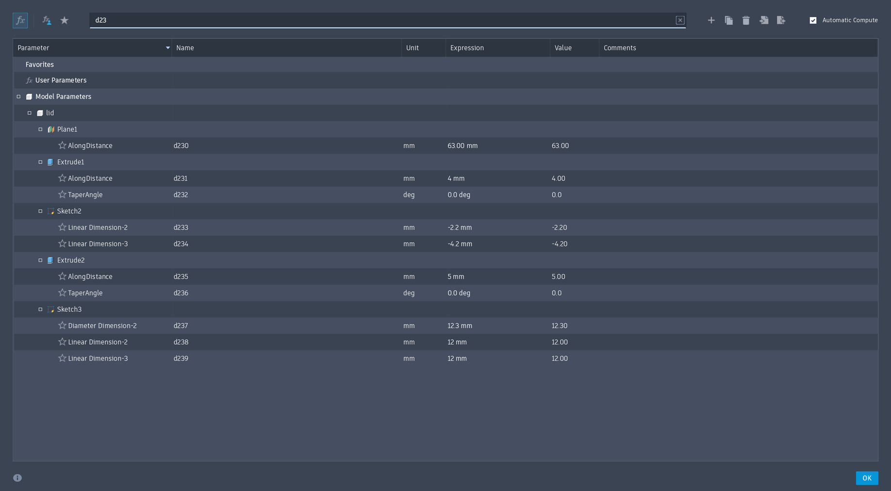

# Lid guide alignment

The native [Fusion design](stencil_fix_portable.f3d), [STEP assembly](stencil_fix_portable.step) and [lid STL](../stl/lid.stl) use a 138 × 138 mm guide pattern. Print the lid, lifter and PCB holder at 100% scale.

The original lid guide bores were at X/Y = ±68.7 mm (137.4 mm pitch). The lifter guide bosses and the top's screw/spring guides are at X/Y = ±69 mm (138 mm pitch). The 0.424 mm diagonal offset exceeded the 0.4 mm radial clearance between each 11.5 mm lifter boss and its 12.3 mm lid bore.

Only the four 12.3 mm lid bores through Z = 63–67 mm have moved. Their diameter, the plate thickness, vacuum holes, underside spring seats, lifter, PCB holder and top are unchanged. Scaling the whole lifter also moves its other features and is unnecessary with the corrected lid.

## Edit and export in Fusion

The correction is in `lid:1` → `Sketch3`. The two dimensions from the outer edges to the first bore centre are now 12 mm. The sketch's existing constraints place the other three bores symmetrically.

| Parameter | Purpose | Value |
|---|---|---|
| `d237` | Bore diameter | 12.3 mm, unchanged |
| `d238` | Horizontal edge offset | 12 mm, previously 12.3 mm |
| `d239` | Vertical edge offset | 12 mm, previously 12.3 mm |

The lid edges are at X/Y = ±81 mm, so the 12 mm offsets put the bore centres at X/Y = ±69 mm.

1. Open the native Fusion design. Use **Modify → Change Parameters** to inspect `d237`, `d238` and `d239`.
2. Save the design, then use **File → Export** to export the complete design as `cad/stencil_fix_portable.f3d` and `cad/stencil_fix_portable.step`.
3. Right-click `lid:1` in the browser and choose **Save As Mesh**. Select **STL (Binary)** and **Millimeter**. Start with **High** refinement, then choose **Custom** and set surface deviation to **0.005 mm** and normal deviation to **5°**. Leave maximum edge length at **229.27931 mm** and aspect ratio at **21.50**, then save as `stl/lid.stl`.

The artifacts were exported directly from the open Fusion design, saved as **v27**, on 25 October 2026. No STEP repair or STL generation script is required. The earlier PR revision patched the STEP while the native source still had the original pattern; these exports replace that workflow.

The fresh STEP export also includes the existing `impeller_cw:1` component from the newer native design. The previous STEP came from v19 and omitted that alternate impeller. The shared components retain their volumes, bounds and placements; the complete export is not a 24-record text patch.

## Export checks

The exported F3D was reopened in Fusion and the three sketch parameters were checked again. Independent, read-only checks of the exports used CadQuery 2.8.0 and Trimesh 5.2.0:

- Lid, lifter and top guide centres are all at X/Y = ±69 mm.
- The lid is one valid solid, with zero lid/lifter and lid/top overlap.
- The lid's face types, areas, centroids and bounds match the previously corrected STEP, within 0.00001 mm for coordinates and 0.00001 mm² for areas.
- The lid volume is 87,320.577067 mm³ and its bounds remain X/Y = ±81 mm, Z = 58–67 mm.
- The STL has 246,524 triangles, consistent winding and one watertight solid. Its volume is 87,348.898415 mm³, a 0.0324% deviation from the STEP.

The default **High** mesh preset produced 0.1276% volume deviation. The custom settings above keep that deviation below 0.1%. These checks do not account for printer shrinkage or assembly tolerances.

## Review before release

Print and dry-fit the corrected lid with an unscaled lifter and top. Check free travel at all four corners, spring seating and impeller clearance before accepting the mechanical change. No physical fit test has been performed for this revision.
