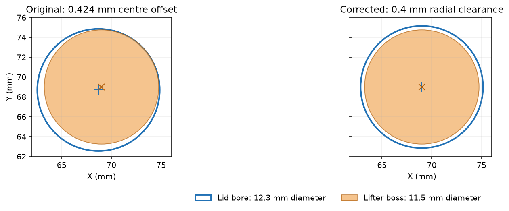

# Lid guide alignment

The STEP assembly and `stl/lid.stl` use a 138 × 138 mm guide pattern. Print the lid, lifter and PCB holder at 100% scale.

The original lid guide bores were at X/Y = ±68.7 mm (137.4 mm pitch). The lifter guide bosses and the top's screw/spring guides are at X/Y = ±69 mm (138 mm pitch). The 0.424 mm diagonal offset exceeded the 0.4 mm radial clearance between each 11.5 mm lifter boss and its 12.3 mm lid bore.

Only the four 12.3 mm lid bores through Z = 63–67 mm have moved. Their diameter, the plate thickness, vacuum holes, underside spring seats, lifter, PCB holder and top are unchanged. Scaling the whole lifter also moves its other features and is unnecessary with the corrected lid.



## Reproduce and check

With Python and `cadquery==2.8.0` installed:

```sh
python cad/align_lid.py cad/stencil_fix_portable.step
```

To regenerate from an original STEP export:

```sh
python cad/align_lid.py /path/to/original.step \
  --output cad/stencil_fix_portable.step --stl stl/lid.stl
```

The repair changes 24 point records defining the bores' axes and seam vertices; all other STEP records remain byte-for-byte unchanged. The script checks all three guide patterns, solid validity, unchanged lid volume and lid interference with the lifter and top after loading the corrected STEP. These checks do not account for printer shrinkage or assembly tolerances.

## Review before release

The native `stencil_fix_portable.f3d` still contains the original 137.4 mm lid pattern. Before exporting from Fusion, change the four lid bore centres to X/Y = ±69 mm, preserving the 12.3 mm diameter and other features, and save the updated native design. Use the corrected STEP for the proposed geometry in this PR.

Print and dry-fit the corrected lid with an unscaled lifter and top. Check free travel at all four corners, spring seating and impeller clearance before accepting the mechanical change. No physical fit test has been performed for this revision.
