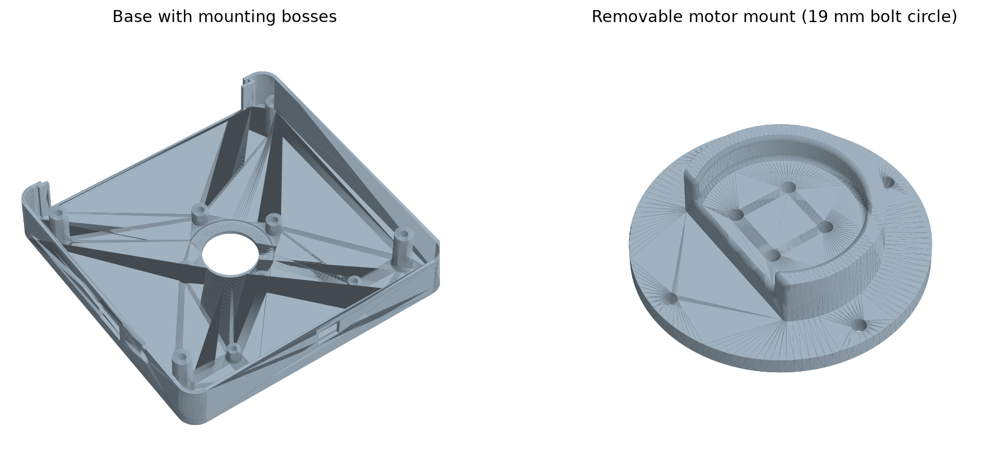

# Removable motor mount prototype

This optional design separates the motor mount from the base so the motor hole pattern can change without reprinting the enclosure. It is an untested proposal for [issue #6](https://github.com/scheffield/stencil-fix-portable/issues/6). The original base and Fusion design remain the released design.



## Parts

Print the modified base and **one** adapter. These adapters require the modified base; they do not fit the original base.

| Part | Printable file | Editable solid |
|---|---|---|
| Modified base | [base_modular.stl](base_modular.stl) | [base_modular.step](base_modular.step) |
| Original CAD motor pattern: four holes on a 19 mm bolt circle | [motor_mount_19mm_pcd.stl](motor_mount_19mm_pcd.stl) | [motor_mount_19mm_pcd.step](motor_mount_19mm_pcd.step) |
| Proposed alternative: four holes on a 16 × 16 mm square | [motor_mount_16mm_square.stl](motor_mount_16mm_square.stl) | [motor_mount_16mm_square.step](motor_mount_16mm_square.step) |

The original CAD hole centres are X/Y = ±6.717514 mm: a 19 mm bolt circle, **not** a 19 × 19 mm square. The alternative uses X/Y = ±8 mm. Measure the actual motor's hole pattern, body, shaft and mounting height before choosing either adapter. The motor size “2306.5” in the issue does not establish its mounting pattern; the 16 × 16 mm version is a proposal, not verified compatibility with that motor.

## Interface and hardware

Dimensions are in millimetres, in the original assembly coordinates.

| Feature | Proposed dimension |
|---|---|
| Motor seating plane | Z = 20, unchanged |
| Original cradle envelope | Radius 22, top at Z = 26 |
| Hub pocket in base | Radius 22.25; 0.25 radial clearance |
| Adapter flange | Radius 32, Z = 10–14 |
| Flange relief in base ribs | Radius 32.25, Z = 10–14.25 |
| Four flange screw centres | (28, 0), (−28, 0), (0, 28), (0, −28) |
| Flange clearance holes | 3.3 diameter |
| Base insert bosses | 9 diameter, Z = 2–10 |
| Insert pilot holes | 4.2 diameter, 4 deep from Z = 10 |
| Central screwdriver opening in base floor | 30 diameter |

Additional hardware: four M3 × 10 socket-head screws and four M3 heat-set inserts, 4 mm long, selected for the 4.2 mm pilot holes. The pilot diameter follows the existing base design; confirm it with the chosen insert and print material. Screw heads sit above the flange at Z = 14; nominal 3 mm heads end at Z = 17. The 10 mm shanks end at Z = 4, above the 2 mm floor.

Use the original motor fasteners only if their engagement suits the selected motor. A different motor can require different screw lengths and shaft/impeller changes even when its mounting holes match.

The base retains its outer dimensions and electronics/enclosure fixing points. Material is removed from the central ribs to clear the flange, so stiffness still needs testing. The flange and its screws occupy more space around the motor than the original mount; check the actual battery, ESC and wiring because they are not fully represented in the CAD.

## Build and verify

With Python and `cadquery==2.8.0` installed, run from the repository root:

```sh
python cad/motor_mount/generate.py
```

The generator derives the parts from `cad/stencil_fix_portable.step`. Use `--output-dir /tmp/motor-mount` to write elsewhere. It checks the input motor pattern, valid solids, matching flange/insert patterns, the unchanged motor seating plane, nominal screw envelopes and zero base/adapter interference. It repeats the fit checks after loading the generated STEP files.

The files retain their assembly Z coordinates. Place each part on the print bed in the slicer and inspect support requirements for the flange overhang and motor-screw counterbores. Install the inserts in the base bosses, attach the motor to its adapter, and bolt the adapter to the base with the four flange screws. Replacing the adapter requires opening the enclosure to access these screws.

## Review before release

- Confirm the target motor's dimensions and choose the required adapter pattern.
- Print and dry-fit the base, adapter and inserts; check screw access, seating and repeatable alignment.
- Check the battery, ESC, wire routing, motor/impeller position and clearance through a full rotation with power disconnected.
- Test stiffness, vibration, temperature and vacuum performance in the assembled enclosure.
- Adjust clearances and hardware from those results before making this the default design.

No print, load, thermal or running-motor test has been performed. Solid validity and nominal fit do not establish mechanical strength or suitability for a particular motor.
